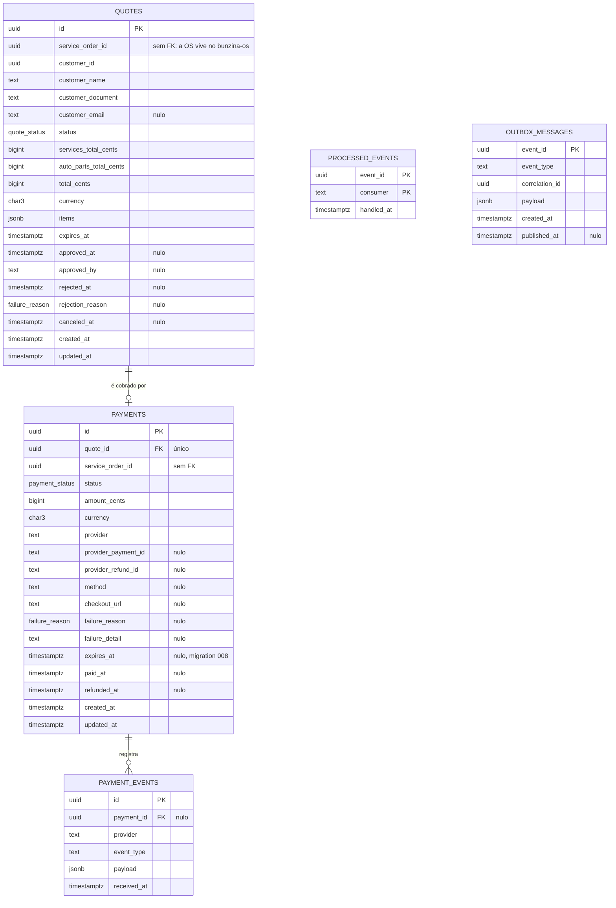

# Diagrama ER do Billing

Modelo do banco do `bunzina-billing`, baseado nas migrations `001` a `008` do repositório
[bunzina-billing](https://github.com/Bunzina/bunzina-billing/tree/main/migrations). É um
PostgreSQL próprio do serviço, com o schema `bunzina`
([ADR 0012](../adrs/0012-microservices-split.md)), separado do banco do monólito descrito em
[er.md](./er.md).

`PROCESSED_EVENTS` e `OUTBOX_MESSAGES` não têm FK: são a infraestrutura da mensageria
transacional e não se ligam ao domínio por chave.

## Enums

| Tipo | Valores |
| --- | --- |
| `quote_status` | `ISSUED`, `APPROVED`, `REJECTED`, `EXPIRED`, `CANCELED` |
| `payment_status` | `PENDING`, `CONFIRMED`, `FAILED`, `REFUNDED` |
| `failure_reason` | `PART_UNAVAILABLE`, `EXPIRED`, `REJECTED`, `TIMEOUT`, `PROVIDER_ERROR`, `CUSTOMER_REQUEST`, `UNREPAIRABLE` |

## Cardinalidades e exclusão

| Pai | FK na tabela filha | Pais por filho | Filhos por pai | ON DELETE |
| --- | --- | --- | --- | --- |
| quotes | payments.quote_id | 1 | 0..1 | NO ACTION |
| payments | payment_events.payment_id | 0..1 | 0..* | CASCADE |

`payments.quote_id` tem índice único (`uq_payments_quote_id`), por isso um orçamento tem no
máximo um pagamento. `payment_events.payment_id` é opcional porque a notificação do
Mercado Pago é gravada antes de se saber a qual pagamento ela pertence; as que não
casam com nenhum ficam sem `payment_id`.

## Índices que carregam regra de negócio

| Índice | Garante |
| --- | --- |
| `uq_quotes_active_per_order` em `quotes(service_order_id)` onde `status` é `ISSUED` ou `APPROVED` | Um orçamento ativo por OS, mesmo com duas réplicas concorrentes |
| `uq_payments_quote_id` em `payments(quote_id)` | Um pagamento por orçamento |
| `uq_payments_provider_payment_id` em `payments(provider, provider_payment_id)` onde o id não é nulo | O pagamento do provedor liga a um único Pagamento do Billing |
| `idx_payments_pending_expires_at` em `payments(expires_at)` onde `status = 'PENDING'` | Varredura barata do job de expiração |
| `idx_outbox_messages_pending` em `outbox_messages(created_at, event_id)` onde `published_at` é nulo | Relay do outbox lê só o que falta publicar |
| chave primária `(event_id, consumer)` em `processed_events` | Idempotência do consumo: mensagem repetida é confirmada sem efeito |

## Dinheiro e itens

Valores são inteiros em **centavos** com a moeda ao lado (`BRL`); a conversão para o decimal
do Mercado Pago acontece só na borda do gateway. Os itens do orçamento (serviços e peças com
quantidade e preço unitário) ficam em `quotes.items` como JSONB, fixados na emissão, porque o
Billing não tem catálogo: ele recebe os itens no `cmd.billing.issue-quote`.
