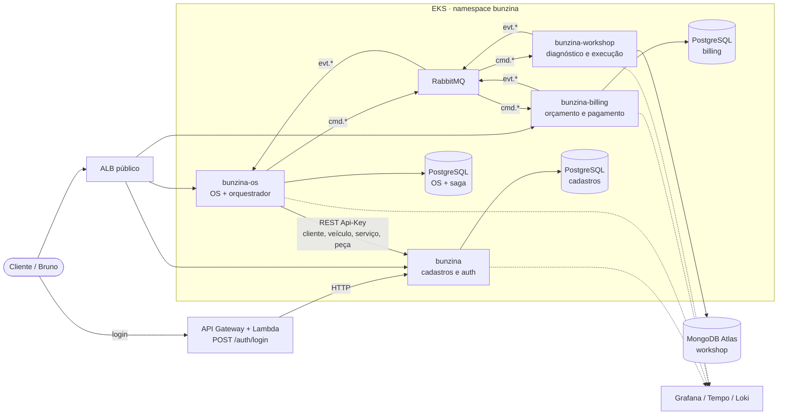

# Arquitetura dos microsserviços (Fase 4)

Visão final da solução: quatro serviços de aplicação, cada um com banco próprio, e
RabbitMQ como único broker. Nenhum serviço acessa o banco de outro
([ADR 0012](../adrs/0012-microservices-split.md)).

O workshop **não tem Ingress/ALB**. Na demonstração: `kubectl port-forward -n bunzina svc/bunzina-workshop 3002:80`.

## Comunicação

| De | Para | Como | Quando |
| --- | --- | --- | --- |
| Cliente | `bunzina` | HTTP no ALB (JWT ou `Api-Key`) | Cadastros e login |
| Cliente | `bunzina-os` | HTTP no ALB | CRUD da OS e entrega |
| Cliente | `bunzina-billing` | HTTP no ALB | Consultar/aprovar orçamento, webhook MP |
| Mecânico | `bunzina-workshop` | HTTP ClusterIP | Diagnóstico e execução |
| `bunzina-os` | `bunzina` | HTTP síncrono + `Api-Key` | Validar cliente/veículo/serviço/peça na criação da OS |
| `bunzina-os` | Billing / Workshop | RabbitMQ, comandos `cmd.*` | Cada passo da saga |
| Billing / Workshop | `bunzina-os` | RabbitMQ, eventos `evt.*` | Resultado de cada passo |

Só o orquestrador publica comandos. Participantes só publicam eventos
([ADR 0013](../adrs/0013-orchestrated-saga.md)). O `serviceOrderId` é o `correlationId`
de todas as mensagens.

## Bancos

| Serviço | Banco | Por quê |
| --- | --- | --- |
| `bunzina` | PostgreSQL no EKS | Cadastro relacional: cliente → veículo, catálogo, estoque |
| `bunzina-os` | PostgreSQL no EKS | OS, itens, `saga_instances`, outbox — ACID + estado demonstrável |
| `bunzina-billing` | PostgreSQL no EKS | Orçamento, pagamento, eventos de pagamento |
| `bunzina-workshop` | MongoDB Atlas | Agregado semiestruturado da fila de execução ([ADR 0014](../adrs/0014-mongodb-workshop.md)) |

Detalhe dos schemas: [database.md](../database.md).

## Sequência da saga

Caminho feliz e compensação: [`bunzina-os/docs/saga-orchestration.md`](https://github.com/Bunzina/bunzina-os/blob/main/docs/saga-orchestration.md).
Contrato das mensagens: [events-saga-contracts.md](../../contracts/events-saga-contracts.md).
