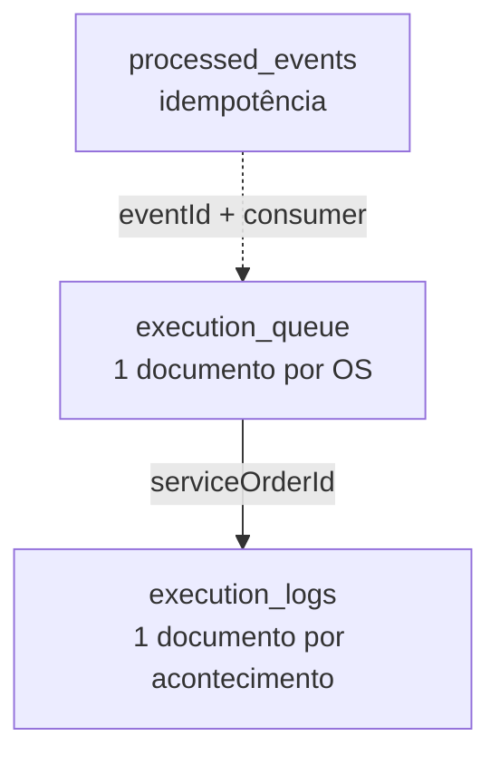

# Modelo de documentos do `bunzina-workshop`

MongoDB Atlas (tier M0). Em desenvolvimento, o `docker-compose` sobe um `mongo` local.
Nenhum StatefulSet de Mongo roda no EKS ([ADR 0014](../adrs/0014-mongodb-workshop.md)).

Três coleções. Índices em `scripts/ensure-indexes.ts` do `bunzina-workshop`.



## `execution_queue`

Agregado da OS na oficina: um documento, chave de negócio `serviceOrderId` única.
Itens embutidos em três listas porque cada fase tem uma forma diferente deles
(pedido, diagnóstico com preço, execução com tempos).

```jsonc
{
  "serviceOrderId": "7f0c...",
  "correlationId": "7f0c...",
  "vehicle": { "id": "c1a2...", "plate": "ABC1D23", "model": "Gol 1.6" },
  "status": "IN_EXECUTION",
  "currency": "BRL",
  "requestedItems": [{ "kind": "SERVICE", "referenceId": "...", "unitPriceCents": 15000 }],
  "diagnosedItems": [{ "kind": "SERVICE", "referenceId": "...", "unitPriceCents": 15000 }],
  "executionItems": [{ "kind": "SERVICE", "isCompleted": true, "executionTimeMs": 5400000 }],
  "diagnosedBy": "mecanico-07",
  "failureReason": null
}
```

Índices: `serviceOrderId` único, `status`, `enqueuedAt`.

## `execution_logs`

Append-only. Um documento por passo (`diagnostic-completed`, `execution-failed`, …).
Nunca é atualizado. `metadata` varia por tipo de evento.

```jsonc
{
  "serviceOrderId": "7f0c...",
  "event": "execution-failed",
  "status": "FAILED",
  "reason": "PART_UNAVAILABLE",
  "detail": "Correia dentada sem estoque",
  "occurredAt": "2026-09-17T15:00:00Z"
}
```

Índices: `serviceOrderId`, `occurredAt` descendente.

## `processed_events`

`{ eventId, consumer }` único. Inserção duplicada (erro `11000`) = comando já processado.

## Por que não PostgreSQL aqui

O dado da oficina é um documento lido e gravado inteiro pela chave da OS. As listas
mudam de formato a cada fase; em tabelas isso vira filhas com colunas nulas ou um
`jsonb`. Não há FK a manter: veículo e itens são snapshots. O Atlas M0 fica fora do
cluster e libera cota para o RabbitMQ.
