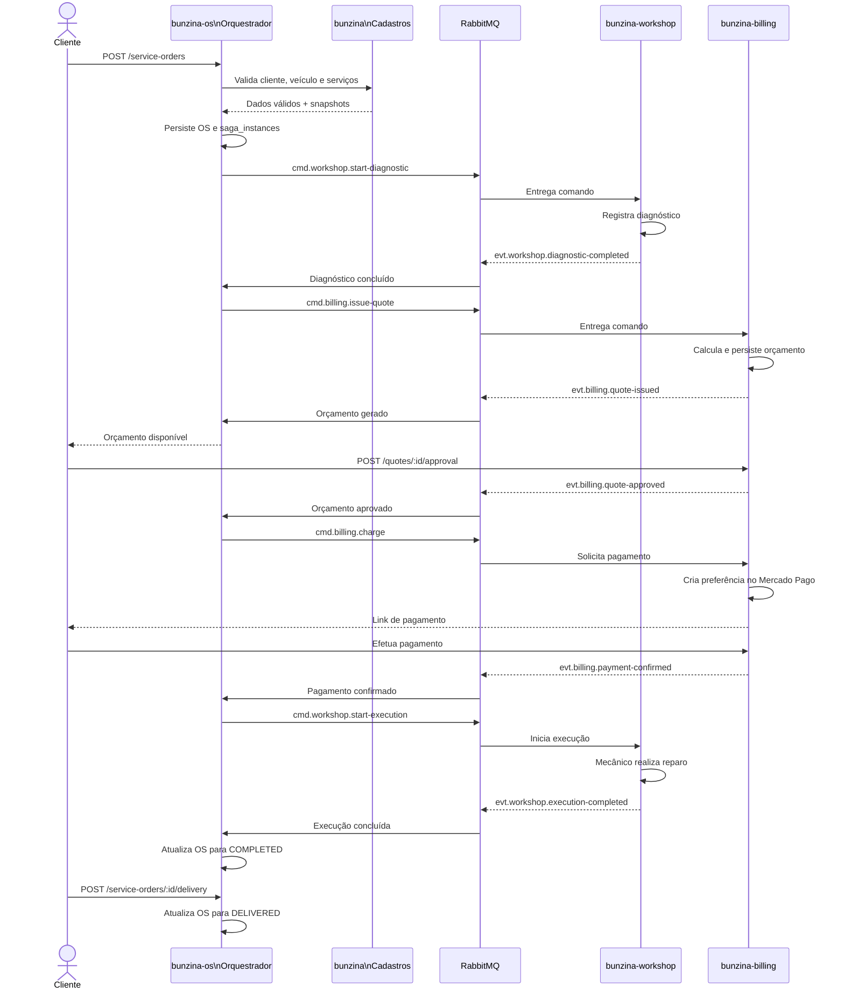
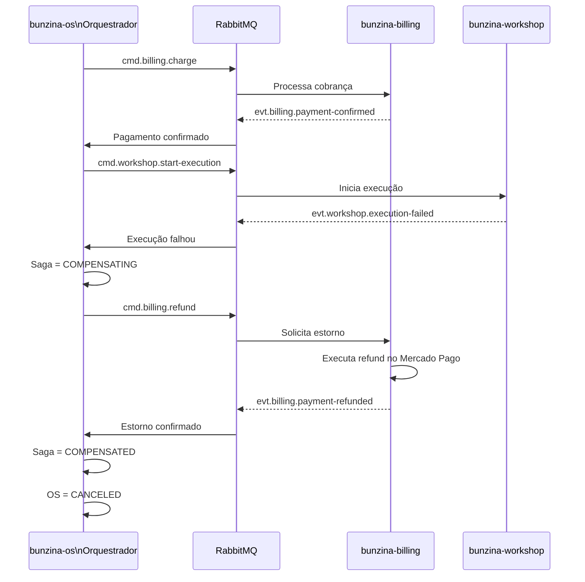
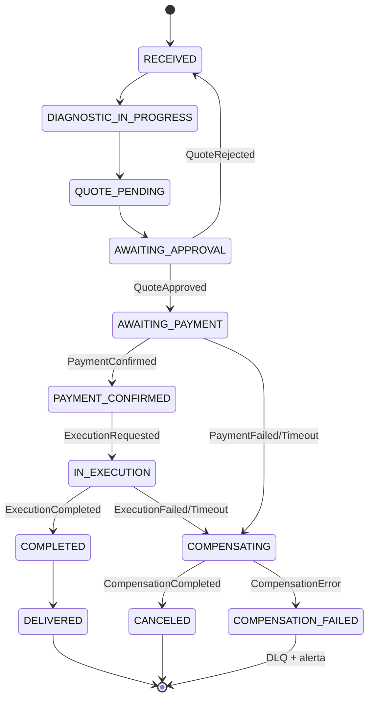

# Saga orquestrada da ordem de serviço

Este documento descreve o fluxo distribuído da ordem de serviço na Fase 4.
O `bunzina-os` é o orquestrador: persiste o estado da saga, publica comandos e reage
aos eventos publicados pelo Billing e pelo Workshop.

O `serviceOrderId` é o `correlationId` de todas as mensagens.

## Componentes

- **bunzina**: valida cliente, veículo e serviços por REST.
- **bunzina-os**: mantém a ordem de serviço e orquestra a saga.
- **bunzina-billing**: gera orçamento, recebe aprovação e processa pagamento.
- **bunzina-workshop**: gerencia diagnóstico, fila de execução e reparos.
- **RabbitMQ**: transporta comandos, eventos e mensagens de compensação.
- **PostgreSQL do OS**: mantém a ordem e a tabela `saga_instances`.
- **PostgreSQL do Billing**: mantém orçamentos e pagamentos.
- **MongoDB do Workshop**: mantém a fila e os logs de execução.

## Caminho feliz



## Falha e compensação

Neste exemplo, o pagamento foi confirmado, mas uma peça ficou indisponível durante
a execução. O orquestrador precisa desfazer o pagamento e cancelar a ordem.



## Estados da saga



## Registro da saga

A tabela `saga_instances` deve manter o progresso suficiente para decidir quais
compensações são necessárias:

```text
service_order_id: 123
status: COMPENSATED
completed_steps:
  - DIAGNOSTIC
  - QUOTE
  - PAYMENT
compensated_steps:
  - PAYMENT
failure_reason: PART_UNAVAILABLE
```

Cada mensagem também deve carregar `eventId`, `eventType`, `eventVersion`,
`correlationId`, `causationId`, `producer`, `occurredAt` e `traceparent`.

## Regras de compensação

| Falha | Compensação |
| --- | --- |
| Falha ou timeout no diagnóstico | Cancela o fluxo, sem cobrança |
| Recusa do orçamento | Retorna a OS para `RECEIVED`; não é falha técnica |
| Falha ou timeout no pagamento | Cancela o orçamento |
| Falha ou timeout na execução após pagamento | Aborta a execução e solicita estorno |
| Falha na compensação | Envia para a DLQ e gera alerta |

Os consumidores devem gravar cada mensagem processada em `processed_events` antes
de confirmar o `ack`. Assim, um redelivery não gera cobrança ou estorno duplicado.

## Referências

- [ADR 0013 - Saga orquestrada](0013-orchestrated-saga.md)
- [ADR 0015 - RabbitMQ](0015-rabbitmq-broker.md)
- [Contratos de eventos da saga](../contracts/events-saga-contracts.md)
